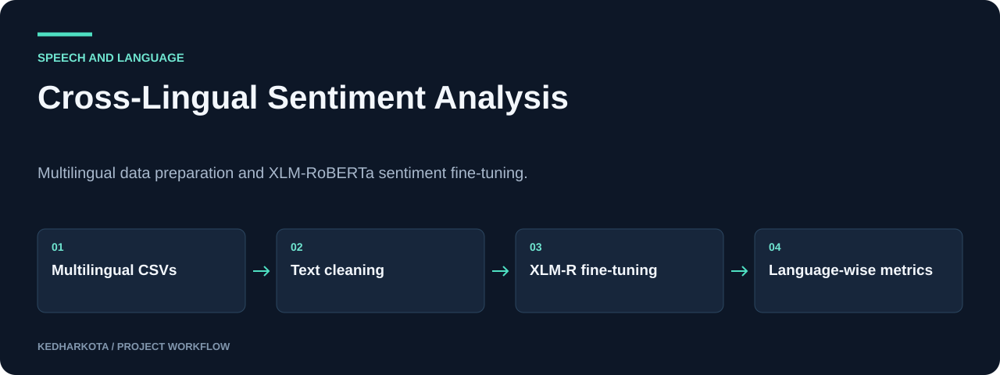

# Cross-Lingual Sentiment Analysis

Multilingual data preparation and XLM-RoBERTa sentiment fine-tuning.

**Python · PyTorch · Transformers · XLM-RoBERTa · pandas**

[](https://github.com/kedharkota/cross-lingual-sentiment-analysis/actions/workflows/docs.yml)

[Overview](#overview) · [Getting started](#getting-started) · [Repository guide](#repository-guide) · [Reproducibility](docs/REPRODUCIBILITY.md)

<p align="center">
  
</p>

[Open full-size visual](docs/assets/overview.svg)

*Explanatory workflow diagram based on the committed project materials.*

## Project at a glance

| Detail | Project information |
| --- | --- |
| **Focus** | Multilingual sentiment classification |
| **Start here** | [xlmr_finetune (1).ipynb](xlmr_finetune%20%281%29.ipynb) |
| **Run mode** | Jupyter notebooks; language CSVs and model downloads required |
| **Explore** | Data-cleaning pipeline, fine-tuning code, and validation routines |

## Overview

A multilingual sentiment-classification experiment combining English, Kannada, Malayalam, and Tamil text. The notebooks prepare consistent text/label tables and fine-tune XLM-RoBERTa with explicit handling of class imbalance.

## What this project includes

- Text cleaning for URLs, mentions, hashtags, emoji, and whitespace.
- Shared `sentence`/`label` schema for the language datasets.
- Class-weighted loss and label-aware sampling during XLM-R training.
- Validation reporting for classes and languages, plus checkpoint persistence.

## Getting started

Create a Python environment with Jupyter, pandas, NumPy, scikit-learn, PyTorch, Transformers, tqdm, emoji, and the plotting libraries used in the notebooks. Select mutually compatible PyTorch/CUDA versions for your hardware.

Run the preprocessing notebook first, then open `xlmr_finetune (1).ipynb`. Replace `BASE_DIR` and other absolute paths before running cells. The Word2Vec-named notebook currently has the same content as preprocessing and is not a separate implemented Word2Vec baseline.

### Required inputs and current constraints

Provide `english_cleaned.csv`, `kannada_cleaned.csv`, `malayalam_cleaned.csv`, and `tamil_cleaned.csv` under the configured `cleaned_data/` directory. Each requires `sentence` and `label` columns. Raw/cleaned datasets and pretrained/fine-tuned weights are not committed. Label meanings and dataset provenance must match your source data.

## Repository guide

| File | Purpose |
| --- | --- |
| [data_preprocessing.ipynb](data_preprocessing.ipynb) | Dataset combination and cleaning. |
| [word2vec-negatice-sampling.ipynb](word2vec-negatice-sampling.ipynb) | Currently duplicates the preprocessing notebook; filename is retained. |
| [xlmr_finetune (1).ipynb](xlmr_finetune%20%281%29.ipynb) | XLM-RoBERTa fine-tuning and validation. |

## Results and project status

The fine-tuning notebook configures a five-epoch run, cosine learning-rate scheduling, early stopping, and per-language evaluation. Its approximately 90% accuracy language is an improvement target, not a verified result. No completed benchmark summary or evaluation figure is included in this README because the inspected notebook outputs do not supply one.

## Next steps

- Document dataset sources, label mappings, and train/validation provenance.
- Replace the duplicate Word2Vec notebook with an actual baseline or rename it for clarity.

## Documentation maintenance

<details>
<summary>Run documentation checks and maintain visuals</summary>

Local documentation links and image headers are checked on pull requests and relevant pushes by the [documentation workflow](.github/workflows/docs.yml). Run the same check locally:

```bash
python tools/check_docs.py
```

See the [reproducibility guide](docs/REPRODUCIBILITY.md) for evidence, missing artifacts, and visual-source notes. The check validates documentation files; it does not train models or certify application behavior.

</details>

## Explore related projects

- [TeluguVoiceBridge / Speech Translation](https://github.com/kedharkota/Voice-Cloning-TTS-)
- [Healthcare Recommendation Research Prototype](https://github.com/kedharkota/Healthcare-Recommendation-System)

---

[More projects by kedharkota](https://github.com/kedharkota?tab=repositories)
